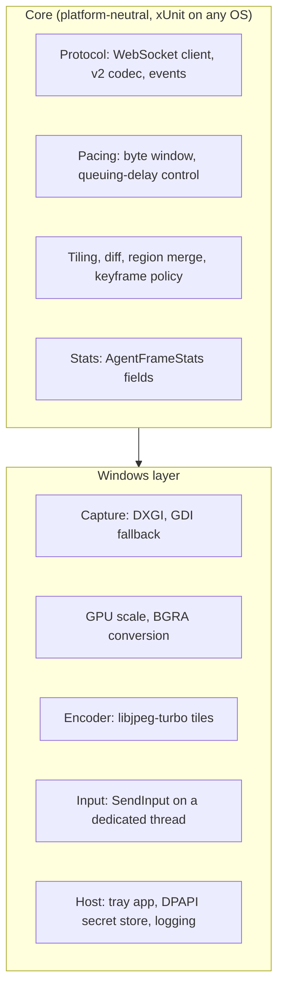

# Spec: Native Windows agent (C# / .NET)

Umbrella issue: #23. Related: #5, #6, #10, #15, #17, #18, #19, #20.

Status: agreed in a design interview on 2026-11-19. Open items are listed at the end.

## Problem

The PowerShell agent (`DeskBridge-Host.ps1`, generated by `server/windowsAgentGenerator.ts`) is the ceiling for frame rate and image quality:

1. GDI capture plus CPU scaling (about 73 ms capture at 911 px in the last field report).
2. GDI+ JPEG encoder (slower and worse per byte than libjpeg-turbo; fixed 4:2:0 chroma).
3. Inline C# compiled by `Add-Type` on every start, C# 5 only, no NuGet.
4. No service mode, so no lock screen, UAC or start before login (#10).
5. Not testable in CI; every agent change needs a manual Windows run.
6. Script distribution: execution-policy prompts, antivirus suspicion, no signing.

## Decisions

| Area | Decision |
| --- | --- |
| Commitment | The native agent is the final solution. No go/no-go gate. Performance numbers are targets, not gates. |
| Audience | The owner only for now. Do not bake in single-user assumptions that block a later product. |
| Repo | Same repo, `agent/windows/`, own `.sln`. Path-filtered CI jobs. |
| Runtime | .NET 10, self-contained single-file `.exe`, x64 only. NativeAOT can be revisited later. |
| OS | Windows 10 and 11. |
| Capture | DXGI Desktop Duplication primary, GDI fallback. Windows.Graphics.Capture is out of phase 1. |
| Bindings | Vortice.Windows for DXGI / D3D11 / Media Foundation. CsWin32 for plain Win32 (`SendInput`, etc.). |
| JPEG | libjpeg-turbo via P/Invoke, one bundled x64 native DLL. |
| Protocol | Phase 1 speaks the existing protocol unchanged (v2 frames, `host:*` events, enrollment key + host secret). Later additions are opt-in by capability so older peers keep working. |
| Enrollment | Phase 1 keeps the embedded enrollment key. One-time enrollment codes are a separate later ticket. |
| Distribution (phase 1) | Portable `.exe`, no admin. Signing, installer and auto-update wait for phase 4. |
| Host UX (phase 1) | Tray app, no console window, visible indicator while a controller is connected, opt-in autostart, log file under `%LOCALAPPDATA%`. |
| Secrets | Host secret stored under `%LOCALAPPDATA%`, encrypted with DPAPI (current user). Never plain text or registry. |
| PowerShell agent | Deleted when the native agent reaches phase 1 parity: `server/windowsAgentGenerator.ts` (PowerShell part), `tests/agentGenerator.test.ts`, the download button. |
| Tests | Platform-neutral Core project tested with xUnit. Golden test vectors (binary frames, event JSON) shared by the TypeScript and C# tests. Windows integration tests on `windows-latest` where possible, capture tests skipped without a usable display. |

## Targets

1. Capture + scale + encode under about 10 ms per frame at 1600 px or wider.
2. 30 fps in normal use (60 later).
3. Input applied on its own thread, never blocked by capture or send.
4. Sharp text at full stream size without the HALFTONE vs COLORONCOLOR trade-off.

Measured with the existing stats strip (`AgentFrameStats`). The PowerShell agent's numbers are the baseline.

## Architecture

The pacing rules in `AGENTS.md` ("Streaming pipeline" and "Latency vs congestion") carry over unchanged: byte-based send window, decisions on queuing delay above the baseline RTT (never absolute RTT), single-slot mailbox of the freshest unsent frame, generation counter against outdated references, keyframe on request / resize / monitor switch / more than 50% changed.

## Phases

| Phase | Scope | Done when |
| --- | --- | --- |
| 0. Walking skeleton | End to end against the real relay: enroll, connect, DXGI capture, JPEG tiles, send frames, basic mouse and keyboard input. | You can control a PC from the phone with the native agent, and stats are visible. |
| 1. Parity | Everything the PowerShell agent does (checklist below), tray app, autostart, relay download, DPAPI secret, logging. | It is the default download and the PowerShell agent is deleted. |
| 2. Quality and feel | Client-side cursor (#17), progressive refinement, zoom-aware region streaming (needs a capability-gated protocol addition), mouse drag (#15). | Text is crisp at rest, cursor feels instant. |
| 3. Video | Media Foundation H.264 with WebCodecs on the phone (#19), JPEG fallback. | Smooth video and scrolling at lower bandwidth. |
| 4. Service | LocalSystem service plus session helper, secure desktop, UAC, Ctrl+Alt+Del (#10), installer, auto-update, signing. | A locked PC can be unlocked remotely. |
| 5. Direct path | WebRTC data channel with relay signalling and fallback (#20). | Lower baseline RTT on the same LAN. |

## Phase 1 parity checklist

Derived from `AGENTS.md`; the native agent must match all of these before the PowerShell agent is removed.

1. `host:register` with `enrollKey`, then `hostSecret` after first enrollment; reconnect and `4409` / `4401` handling; keep-alive pongs.
2. Monitors list, `activeMonitor`, `host:update`, `monitor` input.
3. Per-monitor DPI awareness (process-level PMv2 before any monitor query).
4. All `RemoteInputEvent` types: `mousemove`, `click`, `mousedown`/`mouseup`, `scroll`, `type` (any Unicode, `\n` = Enter), `key` with modifiers, `hotkey`, `quality`, `monitor`. Not `launch`, `shell` or `clipboard`: only the AI assistant sends the first two and nothing sends `clipboard` (Ctrl+C / Ctrl+V cover it), so they leave the protocol with the AI assistant (#12) instead of being ported (decided 2026-11-21, T6).
5. `Win+L` mapped to `LockWorkStation()`.
6. v2 frames with every `AgentFrameStats` field the strip uses, `host:frame_ack`, `host:keyframe_request`, `host:controller_count`.
7. Opt-in keep-awake (power request plus idle-timer nudge for as long as the agent runs, connected or not, unlike the PowerShell agent which only held while a controller was connected; `keepAwake` in `agent.json`, set with `--keep-awake on|off`, a tray toggle in T7).
8. Stream size as a pixel budget (`maxWidth` as a 16:9-equivalent width).
9. Nagle disabled on the socket; capture wakes on input and keyframe requests.

## Security invariants

The invariants in `AGENTS.md` still apply. Additions for the native agent:

1. The agent never logs the host secret, enrollment key or access token.
2. The native agent does not implement `shell` or `launch` (see the parity checklist). If either ever returns, it stays owner-only and never interpolates untrusted strings into a shell command line.
3. A visible indicator is shown while a controller is connected.
4. Service mode and secure desktop access are opt-in and arrive only in phase 4.

## Deferred on purpose

1. Code signing, installer, auto-update (phase 4).
2. One-time enrollment codes (separate ticket).
3. macOS host (#6).
4. ARM64 Windows.
5. NativeAOT.
6. Whether `windows-latest` runners can do real screen capture: verify during phase 0.

## Settled after the first draft

1. **Node agent and `.bat` launcher:** `deskbridge-host.mjs` and the `.bat` launcher are removed together with the PowerShell agent, so `server/windowsAgentGenerator.ts` goes away entirely at parity.
2. **Download flow:** the authenticated download returns a zip with the generic `.exe` plus a small generated config file (relay URL, enrollment key). The `.exe` is a GitHub release asset built by CI on `windows-latest`; the relay does not build or host it for now.
3. **Reference PC:** the owner's development machine (the one running this repo) is the reference for the targets.

## Open items

None. Next step: tickets, with phase 0 first.
